https://github.com/user-attachments/assets/4c51c0f8-7ad9-4b8a-9c32-bd7e6c1ca213
<div align="center">

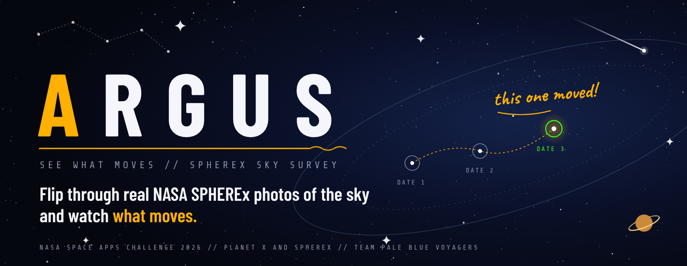

<br>


**[LIVE DEMO](https://argus-nasa.vercel.app/)** &nbsp;|&nbsp; **[QUICK START](#quick-start)** &nbsp;|&nbsp; **[API](#api)** &nbsp;|&nbsp; **[HONEST LIMITS](#limits)**

</div>

<!-- VIDEO SLOT: paste the github.com/user-attachments/... video link on the empty line below, then delete this comment line -->


https://github.com/user-attachments/assets/1c88b944-9cdb-49ef-9b0e-3bd0fc5fcc17


https://github.com/user-attachments/assets/331c991a-ea95-4d49-9103-c7c0af72c583


## In 20 seconds

SPHEREx is a NASA infrared telescope that photographs the whole sky again and again. The pictures are huge science files that most people cannot open.

**ARGUS turns them into a flip-book.** Pick a spot in the sky, load real SPHEREx photos of it from different dates, and watch them. Stars stay still. Anything that moved jumps out.

- Works with real NASA data, not mock-ups
- Three viewing modes: Play, Blink, Difference
- Every frame shows its date, colour of light and detector
- A badge tells you if the data is real (`SPHEREX DATA`) or practice (`SIMULATED`)

> ARGUS **helps a person check candidates by eye**. It does not claim to discover anything by itself. See [Evidence](#evidence).


## What you can do

| Step | You do | ARGUS does |
|:--|:--|:--|
| 1 | Spin the globe | Takes you from Earth to a sky sphere |
| 2 | Pick a spot: sliders, typed RA/Dec, or one of 5 ready targets | Finds every SPHEREx image covering it |
| 3 | Press Load | Downloads small cutouts and keeps only matching colours |
| 4 | Watch in **Play**, **Blink** or **Difference** | Shows date, wavelength and detector on every frame |
| 5 | Flag a candidate, save an image, copy a share link | Draws an expected-position ring for stars with known motion |

| Mode | What it shows | Best for |
|:--|:--|:--|
| **Play** | Frames in date order, like a video | Getting a feel for the field |
| **Blink** | Two dates flipping back and forth | Spotting one dot that jumps |
| **Difference** | Static stars cancel out, changes glow | Making a faint mover obvious |


## Screens

<table>
<tr>
<td width="50%">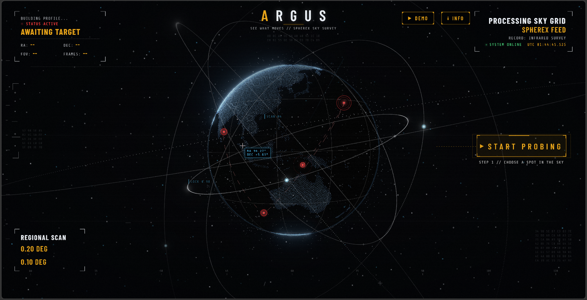<br><sub><b>Landing globe.</b> Start on Earth, look up.</sub></td>
<td width="50%">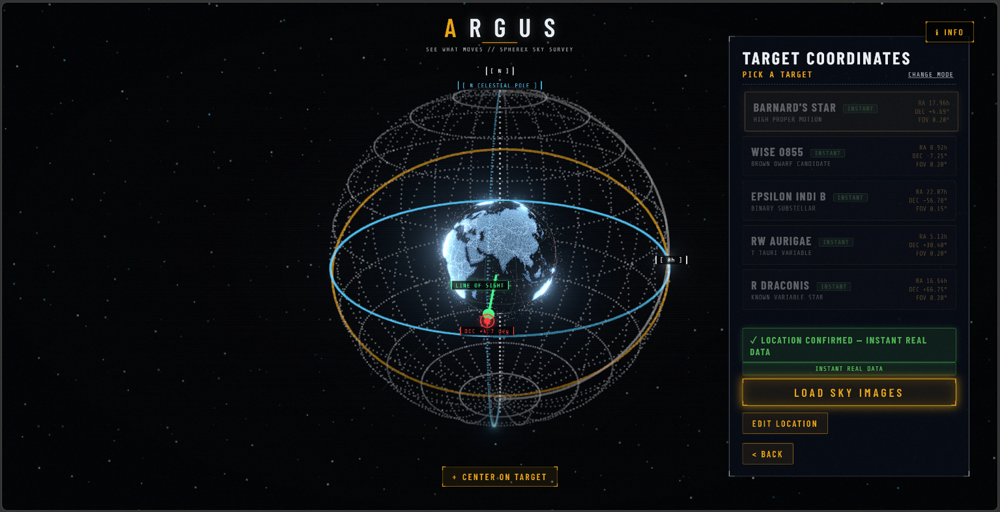<br><sub><b>Sky sphere.</b> Aim the probe with sliders or RA/Dec.</sub></td>
</tr>
<tr>
<td width="50%">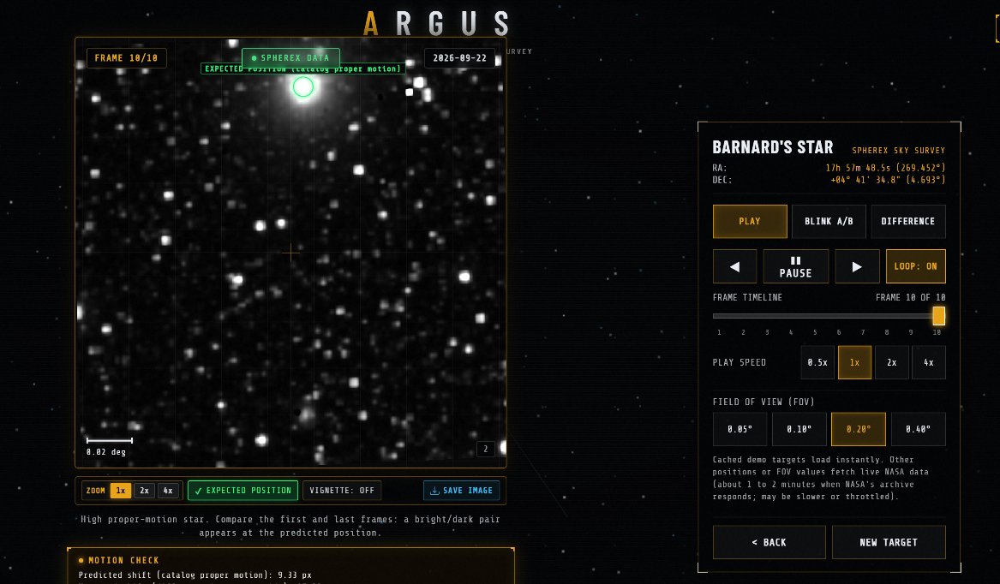<br><sub><b>Play.</b> Real frames in date order.</sub></td>
<td width="50%">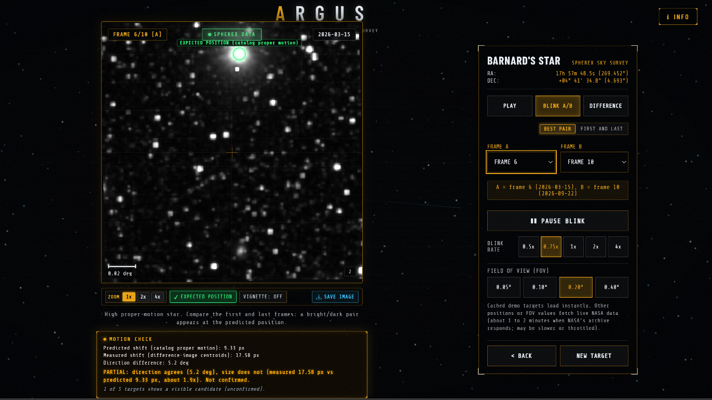<br><sub><b>Blink.</b> Two dates, one flip.</sub></td>
</tr>
<tr>
<td width="50%">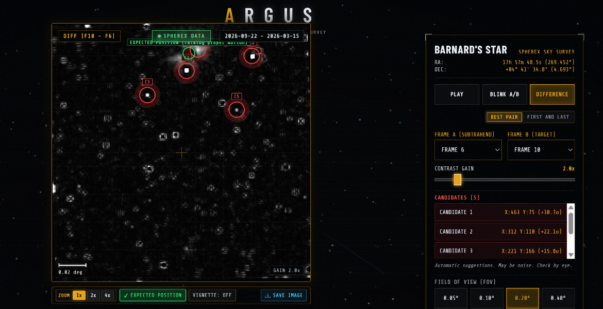<br><sub><b>Difference.</b> Fixed stars vanish, changes glow.</sub></td>
<td width="50%">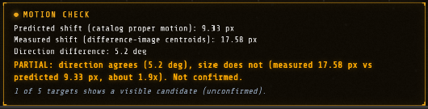<br><sub><b>Motion check.</b> Expected-position ring from catalogue motion.</sub></td>
</tr>
</table>


## How it works

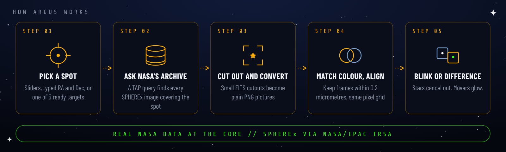

| Stage | Tool | Job |
|:--|:--|:--|
| Find images | IRSA TAP service via `pyvo` | Lists every SPHEREx image that covers your spot |
| Cut out | IRSA cutout service | Downloads a small FITS piece, not the whole file |
| Convert | `astropy`, `numpy`, `Pillow` | Turns FITS into a PNG you can see |
| Know the star | SIMBAD (CDS Strasbourg) | Gives names, coordinates and proper motion |
| Show | Vite, three.js, d3-geo | Globe, sky sphere and the viewer |

**Think of it like this.** SIMBAD is the phone book (who is where and how fast they move). IRSA is the photo library (the real SPHEREx pictures). ARGUS needs both.

### The trick that keeps it honest

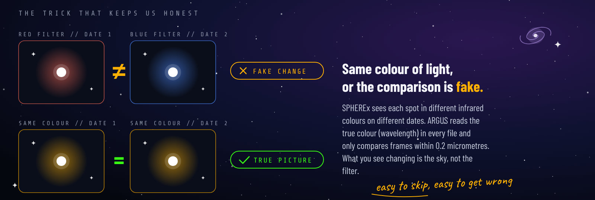

SPHEREx sees the same spot in different infrared colours on different dates. Comparing a red frame with a blue one creates **fake changes**. ARGUS reads the true wavelength at the target from every file and compares only frames **within 0.2 micrometres**.


## Evidence

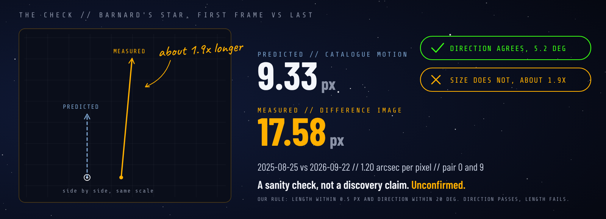

Barnard's Star moves fast across the sky, so it is our test case.

| Measure | Predicted | Measured |
|:--|:--:|:--:|
| Shift in pixels | 9.33 px | 17.58 px |
| Shift in arcseconds | 11.19 | 21.09 |
| Direction difference | | 5.2 degrees |
| Frames used | 2025-08-25 vs 2026-09-22 | pair 0 and 9 |

- Direction agrees. Size does not (about 1.9x too long).
- By our own rule (length within 0.5 px, direction within 20 degrees) this is **NO MATCH**.
- Honest label: **visible by eye, unconfirmed**.

### Target scoreboard

| Target | Result | What we claim |
|:--|:--|:--|
| Barnard's Star | Visible candidate | Best candidate. Unconfirmed |
| Epsilon Indi B | Faint blob, looks like an artifact | Weak. No claim |
| WISE 0855 | Nothing detected | No detection |
| RW Aurigae | Not judged | No claim |
| R Draconis | Not judged | No claim |

1 of 5 targets shows a visible candidate. 0 of 5 pass the automated centroid check. We publish this on purpose.

<details>
<summary><b>Why Epsilon Indi B is a warning, not a win</b></summary>
<br>
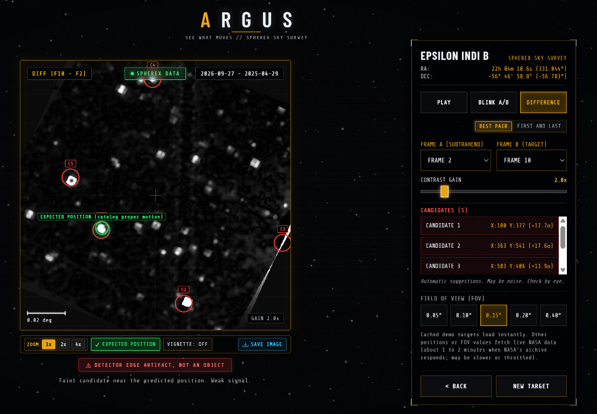
<br>
The faint blob here can come from the detector, not the sky. We show it so users learn to be careful.
</details>


## Quick start

**Windows, one click:** run `start_demo.bat` from the repo root.

**By hand:**

```bash
# 1. Backend (Python 3.11)
cd backend
pip install -r requirements.txt
MOCK=0 DEMO_DIR=demo_cache_final uvicorn server:app --port 8000

# 2. Frontend (new terminal)
cd frontend
npm install
VITE_API_BASE=http://localhost:8000 npm run dev
```

On Windows PowerShell, set variables first: `$env:MOCK="0"; $env:DEMO_DIR="demo_cache_final"`.

### Backend settings

| Variable | Default | Meaning |
|:--|:--|:--|
| `MOCK` | on, unless `"0"` | Serve simulated frames. Set `0` for real data |
| `DEMO_DIR` | | Folder of pre-saved real frames (`demo_cache_final`) |
| `ENABLE_LIVE` | | Allow live fetch from IRSA for custom positions |
| `FORBID_IRSA` | | Block all IRSA calls (safe offline demo) |
| `LIVE_WORKERS` | 4 (max 6) | Parallel downloads. Use 1 or 2, see [Limits](#limits) |
| `LIVE_MAX_JOBS` | | Cap on live jobs at once |
| `LIVE_JOB_MAX_S` | | Time limit per live job, in seconds |

### Frontend settings

| Variable | Meaning |
|:--|:--|
| `VITE_API_BASE` | Backend address the browser calls |
| `VITE_BACKEND_URL` | Backend address for the dev proxy |
| `VITE_ALLOW_LIVE_FETCH` | Show custom-position live fetch in the UI |

Deploying: backend on Render, frontend on Vercel. Steps are in [`DEPLOY.md`](DEPLOY.md).


## API

| Route | What it returns |
|:--|:--|
| `GET /health` | Server status and mode |
| `GET /frames` | Frame list for a target or position, with date, wavelength, detector. Images are served as static files |

Full details: [`API.md`](API.md).

## Limits

We would rather you trust ARGUS than be impressed by it.

| Area | Status | Detail |
|:--|:--|:--|
| 5 ready targets | Works | Pre-saved real frames, load in seconds |
| Custom position | Works, slow | Live fetch took about 1 to 2 minutes for 6 frames in our test |
| Parallel downloads | Throttled | With 4 and 6 workers IRSA returned HTTP 503 and some sets came back incomplete |
| Automatic detection | Not built | Motion is judged by eye |
| Barnard's Star size match | Fails | Measured shift is about 1.9x the predicted one |
| Known bad frame | Open | Barnard's frame 02 (2025-08-27) is a bad cutout, its target marker is removed |
| Fake data | Labelled | Practice frames carry a `SIMULATED` badge |

## Roadmap

- Automatic candidate finder, then check it against known asteroids (JPL Horizons)
- Pre-cache popular fields so custom spots load fast
- More targets and a classroom mode
- Fix the Barnard's size gap before claiming a match


## Repo map

```text
backend/
  server.py            FastAPI app
  data_fetch.py        IRSA search and cutouts
  convert.py           FITS to PNG
  demo_cache_final/    Pre-saved real frames
  proper_motion.json   Catalogue motion
  targets_verified.json
  tools/               Measurement scripts and results
frontend/
  src/                 Globe, sky sphere, viewer
docs/                  Slides, references, submission notes
start_demo.bat         One-click Windows demo
DEPLOY.md  API.md  REGRESSION.md
```

## Team

**Pale Blue Voyagers** at NASA Space Apps Challenge 2026, Local Event Bangalore.

| Who | Role |
|:--|:--|
| Manish Chandra Raturi | Frontend, design |
| Shreesha S. | Data pipeline |
| Dalavai Vaishnavi | Backend |

## Data, credits and AI use

- **NASA data:** SPHEREx spectral images from the NASA/IPAC Infrared Science Archive (IRSA), via TAP and the cutout service.
- **Other data:** SIMBAD, CDS Strasbourg (names, coordinates, proper motion). Land shapes from Natural Earth via `world-atlas`.
- **Libraries:** three.js, d3-geo, topojson-client, Vite, FastAPI, uvicorn, astropy, pyvo, astroquery, numpy, Pillow, requests.
- **Fonts:** Barlow Condensed, Share Tech Mono, Caveat.
- **Full list:** [`docs/REFERENCES.txt`](docs/REFERENCES.txt).
- **AI disclosure:** Antigravity (with Gemini and Claude) helped write and debug code and draft docs. Ideas, target choices, checks and decisions were the team's. README artwork is hand-built vector art, not AI-generated images.

> ARGUS is an independent student project. It is not affiliated with or endorsed by NASA, Caltech/IPAC or the SPHEREx mission.

<div align="center">
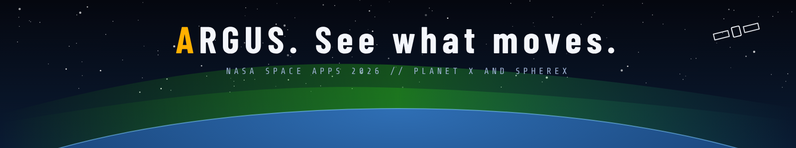
</div>
